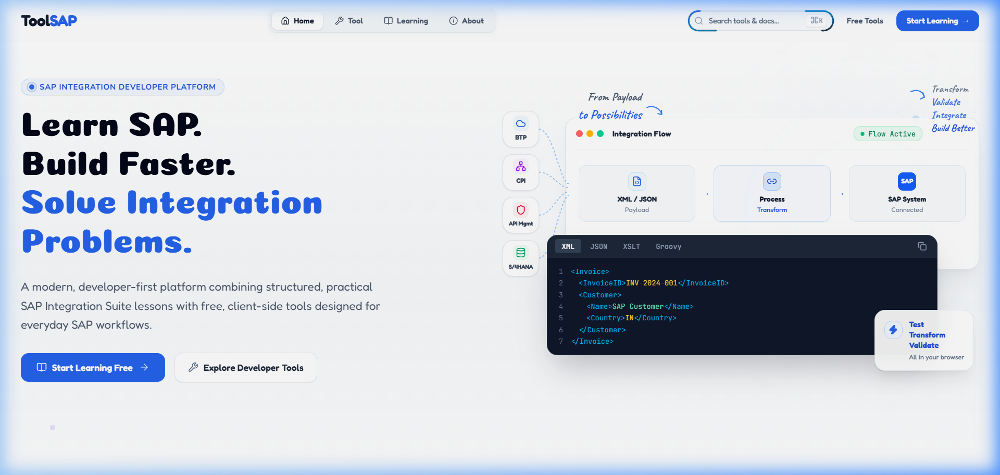
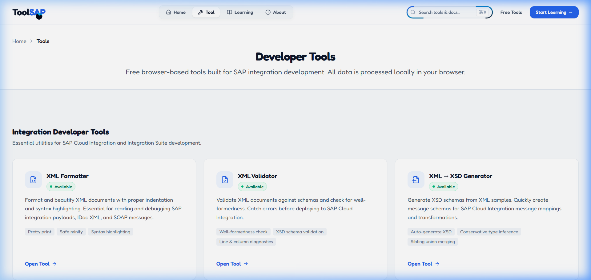
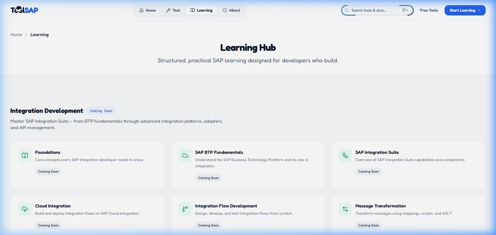
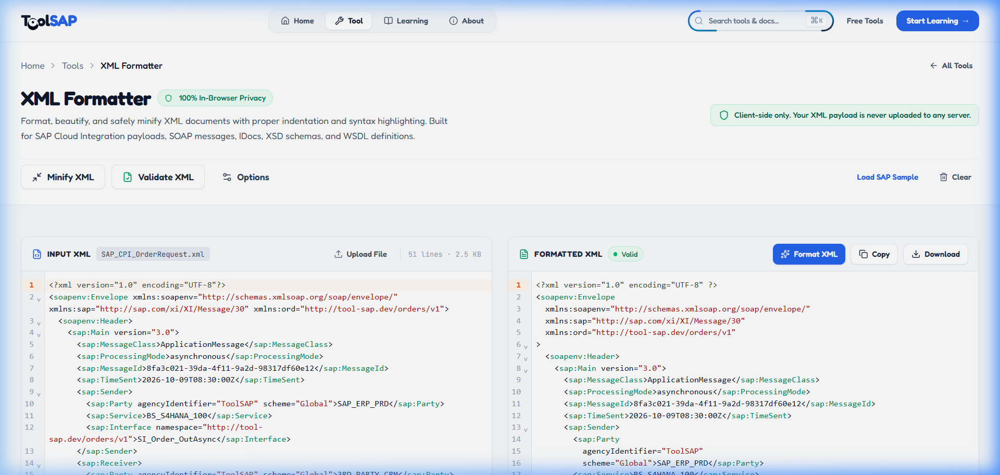
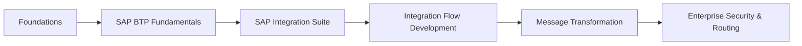

<div align="center">

# ⚡ ToolSAP

### *Learn SAP. Build Faster. Solve Integration Problems.*

**The modern, developer-first platform combining hands-on SAP Integration Suite learning with free, 100% in-browser developer utilities.**

<br />

[](https://react.dev/)
[](https://www.typescriptlang.org/)
[](https://vitejs.dev/)
[](https://tailwindcss.com/)
[](https://expressjs.com/)
[](https://nodejs.org/)

[](#-security--enterprise-privacy)
[](#-license)
[](https://github.com/Arko-009/ToolSAP/pulls)
[](https://github.com/Arko-009/ToolSAP/commits/main)

<br />

[Explore Tools](#-developer-tools-catalog) • [Learning Hub](#-structured-learning-hub) • [Visual Showcase](#-visual-showcase) • [Quick Start](#-quick-start) • [Architecture](#-tech-stack--architecture) • [Roadmap](#-roadmap)

---

</div>

<br />

## 🌟 Overview

**ToolSAP** is built for SAP developers, integration consultants, and enterprise architects working with **SAP Cloud Integration (CPI)**, **SAP Integration Suite**, and **SAP BTP**.

Developing enterprise integrations shouldn't require risking sensitive client data on third-party online tools, nor should it require battling fragmented documentation. ToolSAP solves this with:

1. 🔒 **Zero Data Transmission**: All payload formatters, validators, XSLT generators, and Groovy simulators execute **100% client-side** inside your browser. No sensitive customer IDs, IDoc payloads, or BTP tokens ever touch an external server.
2. 🛠️ **SAP-Specific Developer Utilities**: Pre-configured with enterprise SAP IDoc/SOAP sample templates, Camel exchange header inspectors, Quartz cron validators, and XSD generation.
3. 🎓 **Action-Oriented Learning Hub**: Practical, concept-first curriculum guiding developers through BTP foundations, adapter configurations, message mappings, and routing patterns.

---

## 📸 Visual Showcase

Experience the sleek, modern interface designed with rich typography, glassmorphism accents, and developer ergonomics:

<br />

### 1. 🚀 Home Platform & Interactive Integration Playground
> Visual workflow simulator modeling SAP BTP, Cloud Integration (CPI), API Management, and S/4HANA with interactive multi-language code previews (XML, JSON, XSLT, Groovy).

<div align="center">
  
</div>

<br />

### 2. 🧰 Developer Tools Catalog
> Clean, filterable catalog of specialized tools tailored for SAP Cloud Integration workflows.

<div align="center">
  
</div>

<br />

### 3. 🎓 Structured SAP Learning Hub
> Step-by-step enterprise curriculum covering SAP BTP Fundamentals, SAP Integration Suite, Message Transformation, and Routing.

<div align="center">
  
</div>

<br />

### 4. ⚡ In-Browser Tool in Action: XML Formatter & Live Editor
> Dual-pane code editor with real-time formatting, safe minification, line-numbered syntax highlighting, and 1-click SAP CPI SOAP & IDoc sample loading.

<div align="center">
  
</div>

---

## 🛠️ Developer Tools Catalog

| Tool | Status | Primary Use Case in SAP Workflows | Privacy |
|:-----|:------:|:----------------------------------|:-------:|
| **[XML Formatter](client/src/pages/XmlFormatterPage.tsx)** | `🟢 Available` | Pretty-print, beautify, and minify SAP IDocs, SOAP envelopes, and XML payloads | 100% In-Browser |
| **[XML Validator](client/src/pages/XmlValidatorPage.tsx)** | `🟢 Available` | Validate XML well-formedness and XSD schemas with line & column diagnostics | 100% In-Browser |
| **[XML → XSD Generator](client/src/pages/XmlToXsdPage.tsx)** | `🟢 Available` | Automatically infer and generate XSD message schemas from sample XML payloads | 100% In-Browser |
| **[XPath Tester](client/src/pages/XPathTesterPage.tsx)** | `🟢 Available` | Test and debug XPath expressions for CPI Content-Based Routers and filters | 100% In-Browser |
| **[XSLT Generator & Tester](client/src/pages/XsltGeneratorPage.tsx)** | `🟢 Available` | Generate XSLT mappings from XML samples with 12 enterprise CPI recipes | 100% In-Browser |
| **[Groovy Script Tester](client/src/pages/GroovyTesterPage.tsx)** | `🟢 Available` | Simulate and debug CPI Groovy scripts, inspect headers, properties & body diffs | 100% In-Browser |
| **JSON ↔ XML Converter** | `🟡 Coming Soon` | Bi-directional format transformation for REST-to-SOAP and OData scenarios | 100% In-Browser |
| **Base64 Payload Converter** | `🟡 Coming Soon` | Encode/decode Base64 payloads, Basic Auth strings, and binary MIME attachments | 100% In-Browser |
| **SAP JWT & OAuth2 Decoder** | `🟡 Coming Soon` | Decode and inspect SAP BTP XSUAA and IAS OAuth tokens with scope validation | 100% In-Browser |
| **CPI Header & Property Simulator** | `🟡 Coming Soon` | Preview Camel exchange state transitions and Content Modifier execution | 100% In-Browser |
| **URL & OData Query Encoder** | `🟡 Coming Soon` | Safely encode and parse complex SAP OData query options (`$filter`, `$expand`) | 100% In-Browser |
| **Quartz Cron Expression Parser** | `🟡 Coming Soon` | Validate and humanize Quartz cron schedules for CPI Timer Start Events | 100% In-Browser |

---

## 🎓 Structured Learning Hub

ToolSAP organizes SAP knowledge into developer-friendly, bite-sized modules:



- 📘 **Foundations**: Core enterprise integration concepts, asynchronous vs. synchronous messaging, and SAP architectures.
- ☁️ **SAP BTP Fundamentals**: Global accounts, subaccounts, cloud foundry environments, and service bindings.
- 🧩 **SAP Integration Suite**: Cloud Integration (CPI), API Management, Open Connectors, and Integration Advisor.
- 🔀 **iFlow Development**: Step-by-step guide to building resilient end-to-end integration flows.
- 🔄 **Message Transformation**: Mastering Message Mappings, XSLT, Groovy scripts, and character encodings.

---

## 🔒 Security & Enterprise Privacy

Enterprise SAP data often contains confidential business partners, financial figures, or proprietary schematics.

```
┌─────────────────────────────────────────────────────────────┐
│                    Your Local Web Browser                   │
│                                                             │
│   [ Raw Payload / IDoc ] ──> [ Client-Side Web Worker ]     │
│                                      │                      │
│                                      ▼                      │
│   [ Formatted / Transformed ] <── [ In-Memory Execution ]  │
│                                                             │
│         ❌ NO PAYLOAD DATA IS EVER SENT OVER THE NETWORK    │
└─────────────────────────────────────────────────────────────┘
```

- **Zero Remote Storage**: Your XML, JSON, Groovy scripts, and authorization tokens remain strictly inside your browser tab's memory.
- **Offline Capable**: Core parsers and formatting utilities run without needing an internet connection once loaded.
- **Auditable Source Code**: Full transparency over how client-side transformations and parsers operate.

---

## 🏗️ Tech Stack & Architecture

### Frontend (Client)
- **Core Framework:** [React 19](https://react.dev/) + [TypeScript](https://www.typescriptlang.org/)
- **Bundler & Dev Server:** [Vite 8](https://vitejs.dev/) with lightning-fast HMR
- **Styling:** [Tailwind CSS v4](https://tailwindcss.com/)
- **Routing:** [React Router v7](https://reactrouter.com/) (Code-split with lazy loading)
- **Editor & Code Highlighting:** [@uiw/react-codemirror](https://github.com/uiwjs/react-codemirror) with XML and JSON syntax engines
- **XML & XPath Engines:** `fontoxpath`, `xslt-processor`, `@xmldom/xmldom`, `@prettier/plugin-xml`
- **Animations & Icons:** [Framer Motion](https://www.framer.com/motion/), [Three.js](https://threejs.org/), and [Lucide React](https://lucide.dev/)

### Backend (Server)
- **Runtime:** [Node.js](https://nodejs.org/) (>= 20.0.0)
- **Server Framework:** [Express 5](https://expressjs.com/) with TypeScript
- **Database:** [MongoDB](https://www.mongodb.com/) via [Mongoose 8](https://mongoosejs.com/)
- **Security & Optimization:** Helmet security headers, CORS protection, and gzip compression

---

## ⚡ Quick Start

### Prerequisites
Make sure you have the following installed on your machine:
- **Node.js** `>= 20.0.0`
- **npm** `>= 10.0.0`
- **MongoDB** (Local instance or MongoDB Atlas connection string)

### 1. Clone the Repository
```bash
git clone https://github.com/Arko-009/ToolSAP.git
cd ToolSAP
```

### 2. Install Dependencies
ToolSAP utilizes npm workspaces to install all dependencies for both `client` and `server` in a single command:
```bash
npm install
```

### 3. Configure Environment Variables
```bash
cp .env.example .env
```
Update `.env` with your preferred configuration (e.g., MongoDB URI, Port).

### 4. Run Development Servers
```bash
# Run both frontend (port 5173) and backend (port 5000) concurrently
npm run dev

# Or run frontend only
npm run dev:client

# Or run backend only
npm run dev:server
```

Open [http://localhost:5173](http://localhost:5173) in your browser to view the application!

### 5. Build for Production
```bash
# Build the client production bundle
npm run build

# Build the server production bundle
npm run build:server
```

---

## 📁 Repository Structure

```
ToolSAP/
├── 📁 client/                       # React 19 + TypeScript frontend
│   ├── 📁 public/                   # Static assets, icons, manifest
│   ├── 📁 src/
│   │   ├── 📁 assets/               # Brand vectors, hero illustrations
│   │   ├── 📁 components/           # Reusable UI & layout modules
│   │   │   ├── 📁 common/           # SEO, loading states, modals
│   │   │   ├── 📁 home/             # Hero, curriculum, tools showcase
│   │   │   ├── 📁 layout/           # AppShell, Navbar, Footer
│   │   │   └── 📁 ui/               # Buttons, badges, toasts, inputs
│   │   ├── 📁 data/                 # Tools registry, curriculum metadata
│   │   ├── 📁 hooks/                # Custom React hooks (toast, copy, media)
│   │   ├── 📁 pages/                # Individual tool pages & learning hub
│   │   ├── 📁 types/                # TypeScript interface definitions
│   │   └── 📁 utils/                # XML parsers, formatters, helpers
│   ├── 📄 package.json
│   └── 📄 vite.config.ts
├── 📁 server/                       # Express 5 + TypeScript backend
│   ├── 📁 src/
│   │   ├── 📁 config/               # Environment & database configs
│   │   ├── 📁 middleware/           # Error handling, rate limits
│   │   └── 📁 routes/               # API endpoints & health checks
│   ├── 📄 package.json
│   └── 📄 tsconfig.json
├── 📁 docs/                         # Documentation assets & screenshots
│   └── 📁 screenshots/              # 4 high-resolution showcase captures
├── 📄 .env.example                  # Environment variable blueprint
├── 📄 package.json                  # Root npm workspace orchestrator
├── 📄 vercel.json                   # Production deployment routing & headers
└── 📄 README.md                     # You are here!
```

---

## 🗺️ Roadmap

- [x] **Phase 1: Core Foundation & Design System**
  - [x] Responsive layout with glassmorphic cards and dark/light accents
  - [x] Fast client-side navigation with React Router v7
  - [x] Core XML Formatter with real-time beautify and minify
- [x] **Phase 2: Advanced Integration Utilities**
  - [x] XML Validator with XSD validation & line diagnostics
  - [x] XML to XSD Schema Generator
  - [x] Interactive XPath Tester with live evaluation
  - [x] XSLT Generator with 12 enterprise SAP CPI recipes
  - [x] Groovy Script Tester for Camel exchange simulation
- [ ] **Phase 3: Payload & Security Suite**
  - [ ] JSON ↔ XML converter with attribute retention
  - [ ] SAP BTP OAuth2 / JWT decoder with expiry alarms
  - [ ] Base64 payload & Basic Auth header encoder/decoder
  - [ ] Quartz cron expression humanizer & fire times calculator
- [ ] **Phase 4: Community & Offline PWA**
  - [ ] Progressive Web App (PWA) offline installation
  - [ ] Community-contributed Groovy script & XSLT template repository

---

## 🤝 Contributing

Contributions, issues, and feature requests are welcome!

1. Fork the Project
2. Create your Feature Branch (`git checkout -b feature/AmazingFeature`)
3. Commit your Changes (`git commit -m 'Add some AmazingFeature'`)
4. Push to the Branch (`git push origin feature/AmazingFeature`)
5. Open a Pull Request

---

## 📄 License

Proprietary. All rights reserved. See repository terms for details.

---

<div align="center">

Crafted with ❤️ for the **SAP Developer Community** by **[@Arko-009](https://github.com/Arko-009)**

*If you find ToolSAP useful, don't forget to give it a ⭐ on GitHub!*

</div>
